# ARC STRUCTURE

## TRUSS AI Design Studio

AI-Powered Structural Design, 3D Modeling & Safety Analysis

[](https://www.python.org/)
[](https://streamlit.io/)
[](https://scikit-learn.org/)
[](https://pandas.pydata.org/)
[](https://numpy.org/)
[](https://www.reportlab.com/)
[](https://plotly.com/)

[GitHub Repository](https://github.com/darshanhv296/ARC-STRUCTURE)

ARC STRUCTURE is a design-assistance application for truss and structural framing workflows. It combines a trained machine-learning pipeline with deterministic reference rules, geometric generation, BOM material calculations, and PDF/CSV exports to help generate feasible truss concepts from site and roof inputs. The project blends ML-based predictions with constrained engineering logic to keep generated outcomes consistent with the reference catalogue and layout rules used by the application.

This repository is intended for engineers, students, and developers exploring how model-based prediction, deterministic geometry generation, and practical output reporting can work together in a structural design workflow. It is not a substitute for professional engineering certification or a final structural sign-off.

---

## Overview

The project addresses a common design problem: given a building width, length, roofing type, roof configuration, and column height, produce a plausible truss family, geometry, supports, member sizes, and material quantities without manually enumerating every member combination.

The implementation does this in stages:

- User inputs are validated and normalized.
- A sequence of machine-learning models predicts truss family, rise height, and downstream design targets.
- Deterministic rules and reference-design compatibility checks reject unsafe or unsupported layouts.
- Geometry generation creates a detailed truss and supporting member layout.
- BOM calculations estimate material quantities, weights, and roofing takeoff.
- Results can be exported as JSON, CSV, and PDF, with previous validated designs cached for comparison.

This distinction is important:

- ML models predict likely design parameters from the training dataset.
- Deterministic calculations and reference rules resolve supported geometry, span limits, and pipe selection.
- Visualization and export functions render the generated structure and quantity summary.
- Final structural validation still requires qualified engineering review; model metrics are helpful indicators, not proof of structural safety.

---

## Features

The current project includes the following implemented capabilities:

- User input for building width, building length, roofing type, roof sides, column height, and support configuration.
- Roof-family selection with compatibility logic for gable and single-slope configurations.
- AI-assisted prediction of truss family and rise height.
- Sequential prediction of design parameters, including pipe sizes, member counts, spacing, and counts for truss, column, beam, and purlin elements.
- Deterministic support-layout evaluation, including unsupported-bay preference and backup support strategies.
- Pipe-catalog-based section resolution using `main/pipes.csv` and reference layouts.
- Material quantity and weight estimation for structural members and roofing components.
- 3D-style member plotting and CAD-like exported front elevations for generated truss geometry.
- Reference-design support using built-in family geometry rules and reference master dataset for span matching.
- PDF reporting for BOM and truss design outputs.
- Result history and exact-request caching using generated design JSON/CSV metadata.
- Input validation and guardrails for known unsupported or invalid layouts.

Partially implemented or domain-limited aspects:

- The tool is a design assistance workflow, not a licensed structural design certification engine.
- The app favors valid supported/unsupported candidate layouts using deterministic reference rules, but it does not replace a professional structural engineer's review for field execution.
- The project includes reference drawings and geometry patterns but does not implement a full CAD or BIM-based engineering platform.

---

## System Architecture

The architecture follows the project code structure and validation logic used at runtime.

```mermaid
flowchart LR
    A[User Inputs<br/>site width / length / roof / support / materials] --> B[Input Validation and Compatibility Checks]
    B --> C[Feature Preparation for ML Pipeline]
    C --> D[ML Prediction Pipeline<br/>truss family → rise height → design targets]
    D --> E[Guardrails and Reference Rules]
    E --> F[Deterministic Geometry Generation<br/>member layout / support layout / truss family selection]
    F --> G[Material BOM and Roofing Takeoff]
    G --> H[3D / CAD-like Visualization]
    G --> I[JSON / CSV / PDF Exports]
    I --> J[Design History and Candidate Ranking]
    J --> K[User Review / Final Engineering Validation]
```



The actual implementation is a sequential prediction chain, not a general-purpose LLM or broad cloud service architecture. The core stages are data preprocessing, model inference, deterministic rule checks, and design generation.

---

## Technology Stack

The project is Python-based and uses the following verified technologies:

- Python: application runtime and scripting
- Streamlit: interactive user interface (`main/main.py`)
- Pandas: data preprocessing, CSV handling, and dataset transformations
- NumPy: numeric feature handling and array operations
- scikit-learn: preprocessing, model pipelines, encoders, splits, and tree-based model training
- Joblib: model serialization and inference
- XGBoost and CatBoost: optional model candidates in the training pipeline (`files/train_truss.py`)
- Matplotlib and mpl_toolkits: 2D/3D plotting and CAD-like export generation
- Plotly: included in the plotting and reporting stack
- ReportLab: PDF generation (`main/pdf_export.py`)
- CSV/JSON-based storage: design history and result caching (`main/result_history.py`)

The repository does not currently include a top-level `requirements.txt`; dependency installation is inferred from the project imports and should be explicitly recreated if packaging or deployment is needed.

---

## Project Directory Structure

```text
TRUSS/
├── DATASET/
│   └── truss_ai_complete_dataset_10000_purlin_remainder_fixed.csv
├── DESIGNS/
│   ├── BOX.png
│   ├── BOX_TRUSS_1SIDE.png
│   ├── FULL A TRUSS.png
│   ├── HALF_A.png
│   ├── HALF_A_TRUSS.png
│   ├── SEMI_TRUSS.png
│   ├── ZIG-ZAG-A.png
│   ├── ZIG_ZAG_BOX.png
│   ├── ZIG_ZAG_HALF_A.png
│   └── ZIGZAG_BEAM_1SIDE.png
├── files/
│   ├── filter.py
│   ├── preprocess_truss.py
│   ├── test_truss.py
│   ├── train_truss.py
│   ├── truss_common.py
│   └── validate_truss.py
├── main/
│   ├── calculator.py
│   ├── config.py
│   ├── design.py
│   ├── design_options.py
│   ├── main.py
│   ├── master datatset.csv
│   ├── model.py
│   ├── pdf_export.py
│   ├── pipes.csv
│   ├── reference_designs/
│   │   ├── BOX.png
│   │   ├── BOX_TRUSS_1SIDE.png
│   │   ├── FULL A TRUSS.png
│   │   ├── HALF_A.png
│   │   └── SEMI_TRUSS.png
│   ├── result_history.py
│   ├── run_regression.py
│   └── truss_common.py
├── models/
│   └── truss_hybrid_v4/
│       ├── beam_pipe_size.joblib
│       ├── beam_total_count.joblib
│       ├── column_pipe_size.joblib
│       ├── column_spacing_across_span_ft.joblib
│       ├── column_spacing_along_length_ft.joblib
│       ├── column_total_count.joblib
│       ├── frame_chord_pipe_size.joblib
│       ├── pipeline_metadata.json
│       ├── purlin_orientation.joblib
│       ├── purlin_pipe_size.joblib
│       ├── purlin_spacing_ft.joblib
│       ├── rise_height_ft.joblib
│       ├── truss_family.joblib
│       ├── truss_spacing_ft.joblib
│       ├── truss_total_count.joblib
│       ├── web_intermediate_member_count.joblib
│       ├── web_pipe_size.joblib
│       ├── web_spacing_ft.joblib
│       └── web_total_member_count.joblib
├── preprocessed/
│   ├── columns.json
│   ├── preprocessing_report.json
│   ├── reference_master_32_columns.csv
│   ├── test.csv
│   ├── train.csv
│   └── validation.csv
├── results/
│   └── truss_hybrid_v4/
│       ├── test_metrics.json
│       ├── test_predictions.csv
│       ├── training_summary.json
│       ├── validation_metrics.json
│       └── validation_predictions.csv
├── .gitignore
├── .gitattributes
└── README.md
```

### Key directories and files

- `main/main.py`: Streamlit application entry point for the TRUSS AI Design Studio UI.
- `main/design.py`: geometry generation, family compatibility checks, and deterministic layout logic.
- `main/design_options.py`: candidate generation and ranking for unsupported/supported design alternatives.
- `main/calculator.py`: BOM material and roof takeoff calculations.
- `main/model.py`: model status checks and sequential inference with loaded saved bundles.
- `main/pdf_export.py`: report export generation and geometric rendering logic.
- `main/pipes.csv`: pipe catalogue used to resolve member sizes and weight metadata.
- `files/preprocess_truss.py`: dataset validation and CSV preprocessing pipeline.
- `files/train_truss.py`: model selection, training, and validation tuning workflow.
- `files/validate_truss.py`: validation evaluation over the prepared validation split.
- `files/test_truss.py`: final test evaluation over the held-out test split.
- `models/truss_hybrid_v4/`: trained model bundles serialized as `.joblib` files.
- `results/truss_hybrid_v4/`: validation and test metrics, predictions, and summary artifacts.
- `DESIGNS/` and `main/reference_designs/`: reference imagery and visual design examples.

---

## Machine-Learning Pipeline

The project uses a sequential prediction workflow rather than a single monolithic model.

### 1. Source dataset and target variables

The active master dataset is:

- `DATASET/truss_ai_complete_dataset_10000_purlin_remainder_fixed.csv`

The model targets defined in `files/truss_common.py` include:

- `truss_family` (categorical)
- `rise_height_ft` (regression)
- `frame_chord_pipe_size` (categorical)
- `web_pipe_size` (categorical)
- `web_spacing_ft` (categorical)
- `web_intermediate_member_count` (count/regression-like)
- `web_total_member_count` (count/regression-like)
- `truss_spacing_ft` (regression)
- `truss_total_count` (count/regression-like)
- `column_pipe_size` (categorical)
- `column_total_count` (count/regression-like)
- `column_spacing_along_length_ft` (regression)
- `column_spacing_across_span_ft` (regression)
- `beam_pipe_size` (categorical)
- `beam_total_count` (count/regression-like)
- `purlin_pipe_size` (categorical)
- `purlin_orientation` (categorical)
- `purlin_spacing_ft` (regression)

Feature inputs are built from base site and roof parameters, including width, length, roofing type, roof sides, center support, column height, and roof configuration detail.

### 2. Data cleaning and preprocessing

The dataset is standardized in `files/preprocess_truss.py` by:

- validating required columns and required feature fields
- normalizing numeric values and enforcing positive ranges
- handling missing values and invalid categories explicitly
- correcting the single-rafter convention (`None (Single Rafter)` for web members)
- creating group-based splits to limit leakage between similar site geometries
- writing cleaned train/validation/test CSVs into `preprocessed/`

The resulting split files are:

- `preprocessed/train.csv`
- `preprocessed/validation.csv`
- `preprocessed/test.csv`

### 3. Feature schema and target definitions

The fixed schema in `files/truss_common.py` defines:

- `BASE_FEATURES`
- `FAMILY_TARGET`
- `RISE_TARGET`
- `DESIGN_TARGETS`
- `MODEL_TARGETS`

Categorical inputs are one-hot encoded using `OneHotEncoder`, while numeric columns use median imputation.

### 4. Training, validation, and test split strategy

The split logic in `files/validate_truss.py` uses `GroupShuffleSplit` with group keys derived from design/source geometry identifiers and site dimensions. This helps keep similar designs together across splits and reduces leakage risk.

The split sizes are verified in the saved metrics:"rows": 1500 for both validation and final test sets.

### 5. Algorithms and model types used

The pipeline selects from multiple candidate estimators, with the primary family of models being scikit-learn tree-based methods:

- RandomForestClassifier / RandomForestRegressor
- Optional XGBoost models when installed
- Optional CatBoost models when installed
- Dummy baselines for fallback logic

The project is not an LLM or neural-network-based architecture; it is a structured tabular ML pipeline built on tree-based learners and rule-based engineering constraints.

### 6. Individual prediction models and their outputs

The saved model bundle sequence is:

1. `truss_family.joblib` → predicts the truss family.
2. `rise_height_ft.joblib` → predicts roof rise height using the predicted family as an input.
3. Design-stage models for pipe sizes, counts, spacing, and purlin selections.

These models work together in sequence: family prediction feeds rise prediction; then family + rise feed the downstream design targets.

### 7. Model serialization and metadata

The saved model catalog in `models/truss_hybrid_v4/pipeline_metadata.json` records:

- schema version
- feature lists
- target list
- model bundle names
- seed value
- selection source

This metadata is loaded by `main/model.py` before inference.

### 8. Sequential or dependent prediction logic

The inference path in `main/model.py` does the following:

- validate required inputs
- load model catalog and check artifacts
- predict `truss_family`
- use the predicted family to predict `rise_height_ft`
- then predict all downstream design outputs using the predicted family and rise 
- apply guardrails to enforce the single-rafter rule and non-negative integer counts

### 9. Inference-time feature preparation

Inputs are normalized and coerced for the saved models using `_coerce_input_value()` and `clean_features()` in `files/truss_common.py` / `main/model.py`.

### 10. Post-prediction guardrails

The project explicitly applies deterministic rules before accepting predicted designs:

- single-rafter web cases are converted to `None (Single Rafter)` with zero web spacing and zero count values
- count outputs are rounded and clipped to non-negative integers
- roof-family compatibility is enforced through geometry rules
- unsupported-span and support-layout checks are used during candidate ranking and alternative family evaluation

### 11. Validation and final test evaluation

The project produces validation and final test metrics in:

- `results/truss_hybrid_v4/validation_metrics.json`
- `results/truss_hybrid_v4/test_metrics.json`

These files are generated by `files/validate_truss.py` and `files/test_truss.py`. The final held-out test set remains the authoritative evaluation for the saved model bundle.

---

## Model Evaluation and Metrics

The project includes two clearly separated evaluation phases: validation and final test. The results are stored as JSON and should be interpreted separately. High ML metrics indicate prediction performance on the dataset, not guaranteed structural safety.

### Validation metrics

| Target | Type | Accuracy | Macro-F1 | MAE | RMSE | R² |
|---|---|---:|---:|---:|---:|---:|
| `truss_family` | classification | 0.9900 | 0.9531 | — | — | — |
| `rise_height_ft` | regression | — | — | 0.0023 | 0.0053 | 0.999998 |
| `frame_chord_pipe_size` | classification | 0.9860 | 0.9772 | — | — | — |
| `web_pipe_size` | classification | 0.9887 | 0.9445 | — | — | — |
| `web_spacing_ft` | classification | 0.9893 | 0.9273 | — | — | — |
| `web_intermediate_member_count` | regression-like count | — | — | 0.0560 | 0.4775 | 0.9979 |
| `web_total_member_count` | regression-like count | — | — | 0.0733 | 0.6653 | 0.9961 |
| `truss_spacing_ft` | regression | — | — | 0.0042 | 0.0149 | 0.99987 |
| `truss_total_count` | regression-like count | — | — | 0.0007 | 0.0258 | 0.99998 |
| `column_pipe_size` | classification | 0.9993 | 0.9991 | — | — | — |
| `column_total_count` | regression-like count | — | — | 0.0107 | 0.1506 | 0.99985 |
| `column_spacing_along_length_ft` | regression | — | — | 0.0049 | 0.0178 | 0.99989 |
| `column_spacing_across_span_ft` | regression | — | — | 0.0089 | 0.0213 | 0.999998 |
| `beam_pipe_size` | classification | 0.9993 | 0.9991 | — | — | — |
| `beam_total_count` | regression-like count | — | — | 0.0000 | 0.0000 | 1.0000 |
| `purlin_pipe_size` | classification | 1.0000 | 1.0000 | — | — | — |
| `purlin_orientation` | classification | 1.0000 | 1.0000 | — | — | — |
| `purlin_spacing_ft` | regression | — | — | 0.0035 | 0.0200 | 0.99978 |

### Final test metrics

| Target | Type | Accuracy | Macro-F1 | MAE | RMSE | R² |
|---|---|---:|---:|---:|---:|---:|
| `truss_family` | classification | 0.9873 | 0.9356 | — | — | — |
| `rise_height_ft` | regression | — | — | 0.0021 | 0.0047 | 0.999998 |
| `frame_chord_pipe_size` | classification | 0.9827 | 0.9736 | — | — | — |
| `web_pipe_size` | classification | 0.9873 | 0.9346 | — | — | — |
| `web_spacing_ft` | classification | 0.9887 | 0.9152 | — | — | — |
| `web_intermediate_member_count` | regression-like count | — | — | 0.0593 | 0.4851 | 0.9976 |
| `web_total_member_count` | regression-like count | — | — | 0.0813 | 0.6870 | 0.9953 |
| `truss_spacing_ft` | regression | — | — | 0.0051 | 0.0274 | 0.99958 |
| `truss_total_count` | regression-like count | — | — | 0.0033 | 0.0577 | 0.99991 |
| `column_pipe_size` | classification | 1.0000 | 1.0000 | — | — | — |
| `column_total_count` | regression-like count | — | — | 0.0107 | 0.1414 | 0.99985 |
| `column_spacing_along_length_ft` | regression | — | — | 0.0094 | 0.0835 | 0.99759 |
| `column_spacing_across_span_ft` | regression | — | — | 0.0083 | 0.0197 | 0.999998 |
| `beam_pipe_size` | classification | 1.0000 | 1.0000 | — | — | — |
| `beam_total_count` | regression-like count | — | — | 0.0000 | 0.0000 | 1.0000 |
| `purlin_pipe_size` | classification | 0.9993 | 0.9987 | — | — | — |
| `purlin_orientation` | classification | 1.0000 | 1.0000 | — | — | — |
| `purlin_spacing_ft` | regression | — | — | 0.0035 | 0.0240 | 0.99969 |

### Interpretation

- Accuracy measures how often the model is correct overall.
- Macro-F1 is important for class imbalance because it treats each class equally, which helps surface underperforming rare classes.
- MAE measures average absolute error in numeric predictions.
- RMSE penalizes larger errors more strongly.
- R² indicates how much of the variance is explained by the model.

The validation and test metrics show strong performance overall, but the weaker classes are the small minority categories, notably the rare single-rafter cases and the small `Plain Pipe` family class. In the test results, `truss_family` macro-F1 is 0.9356 and `web_pipe_size` macro-F1 is 0.9346. That is still strong for a design-assistance dataset, but it also indicates that rare cases deserve careful review before using the output in a final structural application.

Important caveat: high model metrics do not establish structural safety. The project implements deterministic guardrails and reference compatibility checks, but final engineering review is still required before any design is used in real construction.

---

## Dataset and Reference Assets

### Primary dataset

The active master dataset is stored as:

- `DATASET/truss_ai_complete_dataset_10000_purlin_remainder_fixed.csv`

This file contains the structured design cases used for model training and evaluation. The preprocessing pipeline validates the columns required by the V4 hybrid model schema and writes train/validation/test CSVs into `preprocessed/`.

### Reference design and support data

The project includes a reference design table in:

- `main/master datatset.csv`

This file contains deterministic geometry and support rules used for:

- family-to-roof compatibility
- span envelopes and support layouts
- pipe alias resolution
- design validation and fallback selection

The code in `main/design.py` uses this dataset to reject unsupported geometry and to pick acceptable family/reference combinations for generated designs.

### Pipe catalogue

- `main/pipes.csv`

This is the material catalogue used to resolve pipe size aliases, section dimensions, weight, and standard lengths for BOM calculations.

### Drawing and design imagery

The project includes visual reference assets in:

- `DESIGNS/`
- `main/reference_designs/`

These are not treated as training data by the code; they serve as visual reference examples for roof families and design layouts.

---

## Installation and Setup

The repository is a Python-based project intended to run locally on Windows.

### 1. Clone the repository

```powershell
git clone https://github.com/darshanhv296/ARC-STRUCTURE.git
cd ARC-STRUCTURE
```

### 2. Create a virtual environment

```powershell
python -m venv .venv
.\.venv\Scripts\Activate.ps1
python -m pip install --upgrade pip
```

### 3. Install project dependencies

The project imports the following packages directly and these should be installed into the environment:

```powershell
pip install streamlit pandas numpy scikit-learn joblib matplotlib plotly reportlab xgboost catboost
```

If the environment is being prepared for a smaller runtime or a packaging pass, generate a `requirements.txt` from the active environment after installation.

### 4. Verify required files and artifacts

Before launching the UI, check that the expected project assets exist:

```powershell
Get-ChildItem .
Get-ChildItem .	ools
eview
```

Verify the key directories and files:

```powershell
Get-ChildItem .\DATASET
Get-ChildItem .\preprocessed
Get-ChildItem .\models\truss_hybrid_v4
Get-ChildItem .\results\truss_hybrid_v4
```

The application expects the saved model bundle directory to contain the `.joblib` files from `pipeline_metadata.json`. If these are missing, the UI will report model availability issues.

### 5. Run the application

From the repository root:

```powershell
python -m streamlit run .\main\main.py
```

This starts the TRUSS AI Design Studio UI, where the user can enter project geometry, choose auto/manual design mode, and generate candidate designs.

---

## Usage Notes

- `AUTO — ML-generated design` uses the trained sequential model pipeline to predict a likely family and downstream geometry.
- `MANUAL — User-configured design` keeps the selected family fixed when possible and only falls back to compatible alternatives if the requested family cannot produce a valid candidate.
- Candidate evaluation ranks supported and unsupported bay strategies using deterministic rules, but still requires final engineering review before field adoption.
- Generated results can be exported to JSON, CSV, and PDF from the UI.
- The app stores successful generation results in `results/generated_design_history/` as JSON sidecars and a CSV index via `main/result_history.py`.

---

## Project Status and Limitations

This repository is a working design-assistance and research-oriented project. It demonstrates a realistic end-to-end workflow for: dataset preprocessing, model training, sequential inference, geometry generation, reference validation, BOM estimation, and report export.

Current limits that are important to document:

- The project is not a licensed structural design system.
- Model output is meant to inform design exploration and candidate generation, not to certify safety.
- The repository does not include a formal deployment pipeline or production-grade API service.
- Some generated output is dependent on the reference catalogue and deterministic geometry assumptions in the project data.

---

## Contributing and Extensions

The project is structured to be extended in a few natural directions:

- add more reference families and geometry rules
- broaden the dataset and improve class balance for rare edge cases
- formalize a reproducible environment with a generated `requirements.txt`
- improve model monitoring and confidence reporting for edge-case predictions
- extend export formats or integrate with external CAD/engineering tools

---

## Summary

ARC STRUCTURE is a practical ML-assisted truss design application that combines data-driven prediction with deterministic geometry validation and BOM reporting. The implementation is academically and technically strong in its pipeline design, rule-based guardrails, and project-specific engineering workflow, but it should be used as a design-optimization tool with final human engineering review rather than as an autonomous structural certification system.
